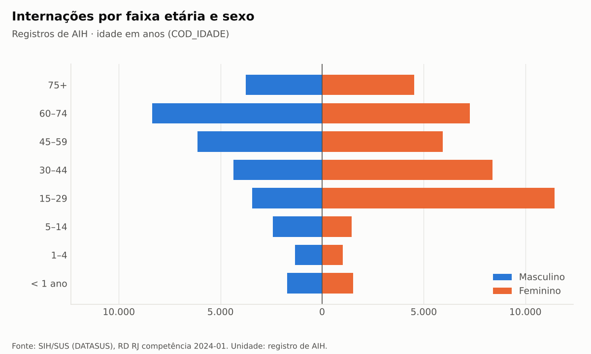

# Hospital Analytics — internações do SUS no Rio de Janeiro (SIH/SUS, competência 01/2024)

Pipeline de dados **reproduzível e auditável** e modelo analítico para Power BI sobre os microdados
públicos do **SIH/SUS** (DATASUS): arquivo `RDRJ2401`, **73.046 registros de AIH** e
**R$ 125.440.636,13** aprovados, enriquecidos com nomes oficiais do **SIGTAP, IBGE, CNES** e das tabelas
do próprio SIH.

> **Status (2026-11-11, branch `work/reference-enrichment`):** pipeline, enriquecimento oficial,
> modelo dimensional, medidas DAX e projeto Power BI (6 páginas) implementados e testados
> (341 testes). O projeto Power BI foi **gerado e validado contra os esquemas oficiais da Microsoft,
> mas ainda não foi aberto no Power BI Desktop** — veja [Dashboard](#dashboard-power-bi).

## O problema

O projeto original (notebook, scripts e dados tratados) foi perdido com o computador em que estava.
Restaram a documentação e os indicadores calculados. Este repositório **reconstrói o projeto a partir
dessas evidências**: cada resultado é recalculado e **reconciliado** com o valor histórico, sem jamais
ajustar dados para "bater" — divergências são investigadas e documentadas.

## Resultados confirmados

| | Histórico | Reproduzido | |
|---|---:|---:|---|
| Registros · colunas | 73.046 · 113 | 73.046 · 113 | ✅ |
| Valor total (`VAL_TOT`) | R$ 125.440.636,13 | R$ 125.440.636,13 | ✅ exato ao centavo |
| AIH tipo 1 · tipo 5 (registros) | 72.383 · 663 | 72.383 · 663 | ✅ |
| Permanência média (geral · tipo 1 · tipo 5) | 6,12 · 5,93 · 27,90 | idem | 🟡 critério identificado (`DIAS_PERM`) |
| Óbitos | 4.664 | 4.664 | 🟡 (`MORTE`) |
| Saídas em 2023 · 2024 | 29.279 · 43.767 | idem | ✅ |

**22 de 24 referências históricas reproduzidas exatamente**; Pandas e DuckDB concordam em todos os
agregados. Tabela completa: [`reports/indicators/reconciliation.md`](reports/indicators/reconciliation.md).

### Achados da reconstrução

- **Idade média histórica (43,96) usa critério incorreto:** ignora a unidade `COD_IDADE` (dias e meses
  somados como anos). Corrigida: **43,85 anos** — publicada ao lado, sem apagar o histórico.
- **"Cirúrgicos 51,57%" mede valor, não internações:** é a participação no `VAL_TOT` (AIH tipo 1).
- **Mortalidade:** 4.664 / 73.046 = 6,385…% → **6,39%** (o histórico 6,38% só se explica por truncamento).
- **Concentração de gastos (58,20%) não reproduzida:** 57,74% pelo critério documentado. *Não use 58,20%.*
- **Rótulos oficiais divergem da fonte secundária** em 3 códigos (ex.: tipo de AIH 1 é "Normal" no
  dicionário oficial do SIH, não "Principal") e dão nome aos 3 códigos de especialidade sem rótulo.

### Destaques descritivos (modelo enriquecido, base completa)

- **Gravidez, parto e puerpério** é o capítulo CID-10 mais frequente (16,5% dos registros); o
  procedimento mais registrado é o **parto normal** (4.250).
- **69,3%** dos registros são de urgência; **22,4%** são de pacientes que residem em município diferente
  do estabelecimento.
- Hospitais da **administração pública municipal** concentram 38,9% do valor; os **10 estabelecimentos**
  de maior valor somam 30,9% do total.
- A mortalidade bruta é maior em doenças infecciosas (20,8%) e respiratórias (16,4%) — taxas **sem
  ajuste de risco**, que refletem o perfil dos casos e não a qualidade do cuidado.



## Dashboard Power BI

Projeto **PBIP** (formato de texto do Power BI) em [`powerbi/`](powerbi/), gerado por
`hospital-analytics pbip` a partir do mesmo esquema que exporta os dados:

| Página | Conteúdo |
|---|---|
| 1. Visão geral | 6 indicadores-chave, tipo de AIH, mês de saída (com aviso: não é série histórica), valor por complexidade, guia de leitura |
| 2. Perfil e origem | pirâmide etária dos **registros**, raça/cor, idade média, residentes de outro município/UF, top 10 municípios |
| 3. Internações e permanência | especialidade do leito, caráter, permanência (geral e AIH principal), tabela de procedimentos SIGTAP |
| 4. Mortalidade hospitalar | taxa bruta por faixa etária, caráter, capítulo CID-10 e top diagnósticos, com aviso metodológico fixo |
| 5. Análise financeira | concentração do valor, curva de Lorenz, grupos SIGTAP, top 10 estabelecimentos, esfera jurídica |
| 6. Qualidade e metodologia | reconciliação com o histórico, completude dos 113 campos, AIHs repetidas, fontes e limitações |

Modelo semântico em **TMDL**: 15 tabelas, 11 relacionamentos (1 inativo, ativado por
`USERELATIONSHIP`), 31 medidas DAX documentadas, colunas técnicas ocultas, tabela de datas e ordenações.
Segmentações (tipo de AIH, caráter, complexidade, faixa etária, sexo) sincronizadas entre as páginas.

**O que foi verificado:** todos os JSON do relatório validados contra os esquemas oficiais da Microsoft;
cada campo usado nos visuais existe no modelo; cada medida tem um equivalente em SQL conferido sobre os
dados exportados ([`reports/powerbi/medidas_referencia.json`](reports/powerbi/medidas_referencia.json)).
**O que falta:** abrir no Power BI Desktop (não disponível no ambiente de construção), atualizar os dados,
conferir os cartões com os valores de referência e capturar as telas — passo a passo em
[`docs/powerbi/README.md`](docs/powerbi/README.md#abrir-o-projeto-no-power-bi-desktop).

## Arquitetura

```text
DATASUS (FTP) ─┐                    ┌─ make fetch-data: Release do GitHub + verificação SHA-256
               ▼                    ▼
        data/raw/RDRJ2401.dbc  (imutável; data/MANIFEST.json)
               │ make convert   .dbc → .dbf → Arrow → Parquet (sem tratamento, CP850)
        data/raw/RDRJ2401.parquet          ← make validate
               │ make processed  originais intactos + 50 colunas derivadas reversíveis
        data/processed/sih_rj_2024_01_tratado.parquet
               ├─ make audit       → reports/audit/
               ├─ make indicators  → reports/indicators/   (Pandas × DuckDB)
               ├─ make analysis    → reports/analysis/     (+ figuras)
               └─ make powerbi     → data/powerbi/*.csv    (modelo estrela + nomes oficiais)
                        ▲                └─ make pbip → powerbi/HospitalAnalytics.pbip
 referências oficiais ──┘  SIGTAP 2024-01 · IBGE · CNES · TabWin SIH (SHA-256 conferido antes da leitura)
```

Módulos e princípios: [`docs/arquitetura.md`](docs/arquitetura.md). Pipeline e camadas:
[`docs/pipeline_dados.md`](docs/pipeline_dados.md).

## Tecnologias

Python 3.13 · pandas · PyArrow/Parquet · DuckDB (SQL versionado em `sql/`) · pyreaddbc + dbfread ·
matplotlib · pytest · ruff · uv (lockfile) · Power BI (TMDL, PBIR, DAX, Power Query M) ·
GitHub Releases (arquivamento dos dados brutos).

## Como reproduzir

Pré-requisitos: [uv](https://docs.astral.sh/uv/), `make` (opcional: sem ele, use os comandos
`uv run hospital-analytics …` mostrados no [`Makefile`](Makefile)) e a CLI `gh` para baixar o arquivo
arquivado. Funciona em Linux e Windows.

```bash
make install      # ambiente idêntico (uv.lock)
```
```bash
make fetch-data   # RDRJ2401.dbc da Release data-rdrj2401, conferido pelo SHA-256 do manifesto
```
```bash
make pipeline     # convert → validate → processed → audit → indicators → analysis → powerbi
```
```bash
make check        # lint + testes (somente dados sintéticos)
```

O passo `powerbi` exige os arquivos oficiais de referência em `data/reference/incoming/` (lista,
tamanhos e SHA-256 em [`config/params.yaml`](config/params.yaml); como obtê-los:
[`docs/recuperacao_dados.md`](docs/recuperacao_dados.md#arquivos-oficiais-de-referência)).

**Reprodutibilidade verificada:** a partir de um *checkout* limpo no Windows, com ambiente criado pelo
`uv.lock`, o pipeline gerou Parquets, relatórios e as 13 CSVs do modelo **byte a byte idênticos** aos
gerados no Linux (as figuras PNG diferem só na rasterização do texto). Duas exportações seguidas dão os
mesmos SHA-256, e o fato continua idêntico ao registrado (`1d1e038b…`).

Para contribuir: [`CONTRIBUTING.md`](CONTRIBUTING.md) (convenções de commit; `make hooks` ativa a verificação).

## Metodologia (princípios)

- **Dados brutos imutáveis**; cada derivado registrado no manifesto com SHA-256 e impressão digital.
- **Nenhum registro removido**: AIHs repetidas (56 excedentes em 50 números) são sinalizadas, não excluídas.
- **Competência ≠ data de ocorrência**: 40% das saídas são de 2023 apesar da competência 2024-01.
- **Dinheiro exato** (centavos inteiros, `Decimal`); **duas engines** devem concordar.
- **Enriquecimento só por código exato e fonte oficial verificada**: chaves únicas, cobertura de 100%
  conferida, colunas apenas acrescentadas e fato preservado byte a byte.
- **Interpretação com fonte declarada** e **saídas sem dados identificáveis**.
- Decisões com contexto, alternativas e consequências: [`docs/decisoes_metodologicas.md`](docs/decisoes_metodologicas.md)
  (D-001 a D-040).

## Limitações

- Unidade de análise = **registro de AIH**: não há identificador de paciente e uma internação longa gera
  vários registros. Taxas são descritivas, **sem ajuste de risco**.
- Uma única competência: a contagem por mês **não** é série histórica.
- Nomes de estabelecimentos vêm do cadastro CNES de **2026-10** (o CNES não publica o nome na competência
  de 2024-01); a data da consulta ao IBGE é o carimbo do arquivo salvo.
- A semântica de alguns campos (ex.: `DIAS_PERM` na longa permanência) segue sem documento primário (P-009).
- O arquivo do DATASUS pode ser republicado; esta análise usa a versão com SHA-256 `a3f0ea9a…0d7dfc9c`.

## Documentação

[Histórico recuperado](docs/historico_recuperado.md) · [Decisões](docs/decisoes_metodologicas.md) ·
[Dicionário](docs/dicionario_variaveis.md) · [Reconciliação](docs/reconciliacao.md) ·
[Indicadores](docs/indicadores.md) · [Qualidade](docs/qualidade_dados.md) · [Análises](docs/analises.md) ·
[Arquitetura](docs/arquitetura.md) · [Pipeline](docs/pipeline_dados.md) ·
[Recuperação](docs/recuperacao_dados.md) · [Diário de execução](docs/diario_execucao.md) ·
[Convenções do projeto](CONTRIBUTING.md) · [Modelo e dashboard Power BI](docs/powerbi/README.md) ·
[Enriquecimento](reports/reference/enriquecimento.md)

## Roteiro

- [x] Fase 1 — Estrutura, ambiente e documentação base
- [x] Fase 2 — Recuperação dos dados (download oficial, checksum, Parquet, CP850)
- [x] Fase 3 — Auditoria e camada tratada
- [x] Fase 4 — Reprodução e reconciliação dos indicadores
- [x] Fase 5 — SQL (DuckDB) e análises exploratórias
- [x] Fase 6 — Camada analítica para Power BI
- [x] Fase 7a — Enriquecimento oficial (SIGTAP, IBGE, CNES, TabWin SIH), medidas e projeto Power BI
- [ ] Fase 7b — Abrir o projeto no Power BI Desktop, conferir e publicar capturas; licença; merge no `main`

## Autoria

Isadora Veiga — projeto de portfólio (Ciência da Computação: engenharia e análise de dados, SQL, saúde).
