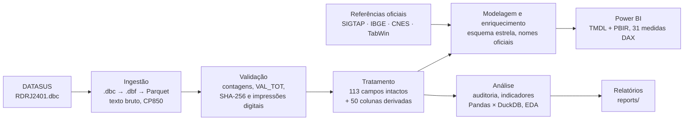

# Hospital Analytics

**Análise das internações do SUS no estado do Rio de Janeiro a partir dos microdados públicos do
SIH/SUS (DATASUS), com dashboard em Power BI apoiado por um pipeline em Python e SQL que torna cada
número reproduzível e auditável.**

| | |
| --- | --- |
| **Pergunta central** | Quem é internado pelo SUS no RJ, em que leitos e procedimentos, com que desfechos e como o valor aprovado se distribui? |
| **Fonte** | SIH/SUS (DATASUS), arquivo RD — *AIH Reduzida* — `RDRJ2401.dbc` |
| **Recorte** | Estado do Rio de Janeiro, competência de processamento janeiro de 2024 (saídas de agosto de 2023 a janeiro de 2024) |
| **Volume** | 73.046 registros de AIH · 113 campos · R$ 125.440.636,13 aprovados · 240 estabelecimentos |
| **Produto final** | Dashboard Power BI com seis páginas, sobre um modelo dimensional validado |

> **Prévia do dashboard:** as capturas das seis páginas da versão final, personalizada no Power BI
> Desktop, ainda não foram publicadas. Elas entrarão em [`assets/dashboard/`](assets/dashboard/).
> A pasta [`powerbi/`](powerbi/) contém hoje o projeto base gerado pelo pipeline
> ([situação do dashboard](#dashboard-power-bi)).

## Principais resultados

| Indicador (base completa) | Valor | Como ler |
| --- | ---: | --- |
| Registros de AIH | 73.046 | 72.990 números de AIH distintos; registro não é paciente |
| Valor total aprovado | R$ 125.440.636,13 | valor pago pelo SUS segundo o SIH, não o custo real do atendimento |
| Valor médio por registro | R$ 1.717,28 | mediana de R$ 689,11: a distribuição é muito assimétrica |
| Permanência média | 6,12 dias | AIH principal: 5,93 dias; longa permanência (tipo 5): 27,90 |
| Mortalidade hospitalar bruta | 6,39% | 4.664 registros com óbito; taxa sem ajuste de risco |
| Idade média | 43,85 anos | calculada pela unidade de idade do registro (dias, meses ou anos) |
| Valor nos 10% maiores registros | 57,74% | metade dos registros de menor valor soma 11,37% |

O que os dados mostram:

- **Obstetrícia lidera o volume.** Gravidez, parto e puerpério é o capítulo da CID-10 mais frequente
  (16,5% dos registros), e o parto normal é o procedimento mais registrado (4.250 registros).
- **A urgência domina.** 69,3% dos registros são de urgência, que responde por 58,8% do valor.
- **O valor é concentrado.** A alta complexidade tem 8,1% dos registros e 29,1% do valor; os 10
  estabelecimentos de maior valor somam 30,9% do total com 18,3% dos registros.
- **A mortalidade acompanha o perfil dos casos.** Ela cresce com a idade (21,8 óbitos por 100 registros
  a partir de 75 anos) e é mais alta nas doenças infecciosas (20,8%) e respiratórias (16,4%). São taxas
  brutas: refletem a gravidade dos casos atendidos, não a qualidade do cuidado.
- **O paciente se desloca.** Em 22,4% dos registros, o município de residência é diferente do município
  do estabelecimento.
- **Achados de qualidade.** Os 241 registros com valor zero são exatamente os 241 do leito "Saúde Mental
  (Clínico)"; 56 registros excedentes compartilham número de AIH com outro registro e foram sinalizados,
  não removidos.

## Contexto e problema

O SIH/SUS registra as internações pagas pelo SUS. Os microdados são públicos, mas chegam em um formato
compactado específico do DATASUS, com códigos sem descrição, datas em texto e regras que mudam o
significado dos números: uma internação longa gera vários registros, a competência é o mês de
processamento e não o de ocorrência, e o valor aprovado não é o custo do atendimento. Usá-los sem
esses cuidados leva a conclusões erradas.

Este projeto nasceu como uma análise exploratória dessa base. O código e os dados tratados originais
foram perdidos com o computador em que estavam; restaram apenas os indicadores calculados na época.
A reconstrução virou uma oportunidade: refazer a análise de forma que **cada número possa ser
reproduzido a partir do arquivo público** e que cada divergência com os valores antigos seja explicada,
não ajustada.

### Perguntas analíticas

1. Qual é o perfil demográfico dos registros de internação (idade, sexo, raça/cor)?
2. Em que leitos, com que caráter e em quais procedimentos e diagnósticos as internações se concentram?
3. Quanto tempo duram as internações e como a longa permanência altera essa leitura?
4. Como a mortalidade hospitalar bruta varia por idade, caráter e capítulo da CID-10?
5. Como o valor aprovado se distribui entre registros, complexidades, procedimentos e estabelecimentos?
6. Os indicadores históricos podem ser reproduzidos, e a base tem problemas de qualidade que afetam a
   leitura?

## Dashboard Power BI

O dashboard é a forma de leitura para quem não vai abrir código nem relatórios. Todas as páginas trazem
a unidade de análise e a fonte no rodapé, e cinco segmentações sincronizadas: tipo de AIH, caráter,
complexidade, faixa etária e sexo.

| Página | Objetivo e perguntas | Indicadores e visuais | Cuidados de leitura |
| --- | --- | --- | --- |
| **1. Visão geral** | Dimensão da base e onde está o valor | cartões de registros, AIHs distintas, valor total e médio, permanência e mortalidade; registros por tipo de AIH e por mês de saída; valor por complexidade | o mês de saída não é série histórica |
| **2. Perfil e origem** | Quem são os registros e de onde vêm | pirâmide etária por sexo, raça/cor, idade média, % de outro município e de fora do RJ, 10 principais municípios de residência | perfil de registros, não de pacientes |
| **3. Internações e permanência** | Leitos, caráter, procedimentos e duração | registros e permanência por especialidade do leito, caráter, permanência da AIH principal, tabela de procedimentos SIGTAP | ler a permanência por tipo de AIH |
| **4. Mortalidade hospitalar** | Como a mortalidade bruta varia | óbitos, mortalidade geral e da AIH principal; por faixa etária, caráter, capítulo e principais diagnósticos | aviso fixo: taxa sem ajuste de risco |
| **5. Análise financeira** | Como o valor se concentra | valor total e médio, parcela dos 10% maiores, curva de Lorenz, grupos SIGTAP, 10 estabelecimentos de maior valor, esfera jurídica | valor aprovado ≠ custo; nomes do CNES de 2026 |
| **6. Qualidade e metodologia** | Quanto confiar nos números | reconciliação com o histórico, completude dos 113 campos, AIHs repetidas, valor zero, fontes e limitações | divergências explicadas, nunca ajustadas |

**Situação.** O modelo semântico (15 tabelas, 11 relacionamentos e 31 medidas DAX) e o relatório de seis
páginas foram gerados pelo pipeline em formato de projeto (PBIP), validados contra os esquemas oficiais
da Microsoft e conferidos medida a medida por equivalentes em SQL. A versão final foi personalizada
visualmente no Power BI Desktop pela autora e **ainda não está versionada** neste repositório, assim
como as capturas das páginas. Detalhes, conferência dos cartões e pendências:
[`docs/07_dashboard.md`](docs/07_dashboard.md).

## Arquitetura



| Etapa | Comando | Saída |
| --- | --- | --- |
| Ingestão | `convert` | `data/raw/RDRJ2401.parquet`: 113 colunas de texto, sem tratamento |
| Validação | `validate`, `verify` | conferência com o manifesto e com os valores históricos |
| Tratamento | `build-processed` | camada tratada com campos originais intactos e colunas derivadas reversíveis |
| Auditoria e indicadores | `audit`, `indicators` | [`reports/audit/`](reports/audit/), [`reports/indicators/`](reports/indicators/) |
| Análise exploratória | `analysis` | [`reports/analysis/`](reports/analysis/) e gráficos |
| Modelo analítico | `powerbi` | 14 tabelas em CSV em `data/powerbi/`, 122 verificações |
| Projeto Power BI | `pbip` | [`powerbi/`](powerbi/); recusa sobrescrever arquivos editados à mão |

## Metodologia

**O que foi feito e por quê.** Cada etapa responde a um risco concreto desta base:

- **Base intocada.** O arquivo oficial é convertido para Parquet como texto, sem tratamento. O tamanho e
  o SHA-256 da fonte e de cada derivado ficam em [`data/MANIFEST.json`](data/MANIFEST.json), e
  impressões digitais provam que nenhum valor original mudou nas etapas seguintes.
- **Valores exatos.** Dinheiro em centavos inteiros e `Decimal`, nunca ponto flutuante: o total confere
  ao centavo.
- **Duas implementações.** Os indicadores são calculados em Pandas e em SQL (DuckDB) de forma
  independente, e os agregados precisam coincidir.
- **Nada é removido.** Registros com número de AIH repetido, valor zero ou permanência atípica são
  sinalizados e contados; os filtros de cada indicador são explícitos.
- **Rótulos com fonte.** Procedimentos e diagnósticos vêm do SIGTAP 2024-01, municípios do IBGE,
  estabelecimentos do CNES e os demais códigos das tabelas do SIH para o TabWin. Cada arquivo de
  referência é conferido por SHA-256 antes da leitura, e o enriquecimento só acrescenta colunas às
  dimensões: a tabela fato permanece idêntica.

**Dificuldades encontradas.** O formato `.dbc` precisa de descompressão específica; o texto usa a página
de código CP850, declarada no próprio arquivo; a idade é registrada em dias, meses ou anos; e alguns
indicadores antigos tinham critérios incorretos ou não documentados. Cada caso virou uma decisão
registrada, com contexto e alternativas, em
[`docs/decisoes_metodologicas.md`](docs/decisoes_metodologicas.md).

**Validação.**

- **Reconciliação com o histórico.** Dos 26 valores históricos recuperados, 24 foram reproduzidos: 22
  indicadores no relatório de reconciliação, mais o número de colunas e a preservação dos campos
  originais, conferidos em outras etapas. "Reproduzido" significa que o critério original foi
  identificado, mesmo quando era inadequado, e os dois números aparecem lado a lado:
  - a idade média histórica (43,96) somava dias e meses como se fossem anos; a corrigida é **43,85**;
  - os "51,57% cirúrgicos" eram parcela do **valor**, não do número de internações (44,97%).
- **Divergências explicadas.** A mortalidade de 4.664 / 73.046 é 6,385%, que arredonda para **6,39%**; o
  histórico de 6,38% só se explica por truncamento. A concentração histórica de 58,20% não foi
  reproduzida pelo critério documentado (57,74%), e o critério original não foi recuperado.
- **Qualidade.** 0 registros duplicados, 0 datas inválidas e 0 valores monetários malformados.
- **Modelo.** 122 verificações: chaves únicas, nenhum registro órfão nos 11 relacionamentos, totais
  preservados e 100% de cobertura dos nomes oficiais.
- **Reprodutibilidade.** O pipeline executado a partir do arquivo oficial gera Parquets e relatórios
  idênticos, byte a byte, aos versionados, no Linux e no Windows.
- **Testes.** Suíte pytest com dados sintéticos: formato DATASUS, conversão, indicadores,
  enriquecimento, projeto Power BI e links da documentação.

Detalhes: [`docs/05_validacao.md`](docs/05_validacao.md).

## Limitações

- A unidade de análise é o **registro de AIH**: não há identificador de paciente, então não é possível
  contar pacientes, reconstruir internações completas nem identificar reinternações.
- Uma única competência não forma série histórica.
- As taxas são brutas, sem ajuste por idade ou gravidade, e não comparam o desempenho de hospitais.
- O valor aprovado é o que o SUS paga pela AIH, não o custo real do atendimento.
- Os nomes dos estabelecimentos vêm do cadastro CNES de 2026-10, não de 2024-01.

Lista completa: [`docs/08_limitacoes.md`](docs/08_limitacoes.md).

## Tecnologias

| Área | Ferramentas |
| --- | --- |
| Análise e transformação | Python 3.13, pandas, PyArrow e Parquet, `Decimal` |
| SQL | DuckDB, com 30 consultas versionadas em [`sql/`](sql/) |
| Leitura do formato DATASUS | pyreaddbc, dbfread |
| Visualização | Power BI (modelo TMDL, relatório PBIR, DAX, Power Query M), matplotlib |
| Qualidade e reprodutibilidade | pytest, ruff, uv com dependências fixadas em `uv.lock`, SHA-256 |

## Como reproduzir

Requisito: [uv](https://docs.astral.sh/uv/), que instala o Python 3.13 e as dependências fixadas. Os
comandos funcionam no Windows (PowerShell) e no Linux.

```bash
uv sync --locked
```

Coloque o `RDRJ2401.dbc`, disponível na Release `data-rdrj2401` deste repositório, em `data/raw/`, e as
tabelas oficiais de referência em `data/reference/incoming/` ([`data/README.md`](data/README.md)).
Depois confira a integridade de todos os arquivos:

```bash
uv run hospital-analytics verify
```

Execute o pipeline na ordem:

```bash
uv run hospital-analytics convert
uv run hospital-analytics validate
uv run hospital-analytics build-processed
uv run hospital-analytics audit
uv run hospital-analytics indicators
uv run hospital-analytics analysis
uv run hospital-analytics powerbi
```

O comando `uv run hospital-analytics pbip` regenera o projeto base do Power BI e recusa sobrescrever
arquivos alterados à mão. Testes e verificação de estilo:

```bash
uv run pytest
uv run ruff check .
```

Em sistemas com `make`, o [`Makefile`](Makefile) oferece os mesmos passos (`make pipeline`, `make check`).

## Documentação

| Etapa | Documento |
| --- | --- |
| 1. Fontes de dados | [`01_fontes_de_dados.md`](docs/01_fontes_de_dados.md) |
| 2. Ingestão | [`02_ingestao.md`](docs/02_ingestao.md) |
| 3. Tratamento e dicionário de variáveis | [`03_tratamento.md`](docs/03_tratamento.md) |
| 4. Modelagem e enriquecimento | [`04_modelagem.md`](docs/04_modelagem.md) |
| 5. Validação | [`05_validacao.md`](docs/05_validacao.md) |
| 6. Análise exploratória | [`06_analise_exploratoria.md`](docs/06_analise_exploratoria.md) |
| 7. Dashboard | [`07_dashboard.md`](docs/07_dashboard.md) |
| 8. Limitações | [`08_limitacoes.md`](docs/08_limitacoes.md) |
| Decisões metodológicas | [`decisoes_metodologicas.md`](docs/decisoes_metodologicas.md) |

Anexos técnicos do modelo, gerados pelo pipeline, em [`docs/powerbi/`](docs/powerbi/): dicionário de
campos, consultas Power Query, medidas DAX e guia das páginas.

## Autoria

**Isadora Veiga** — projeto individual de portfólio em análise de dados e Business Intelligence
aplicados à saúde.
