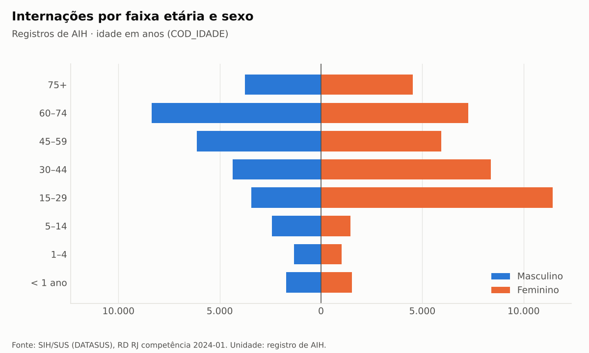
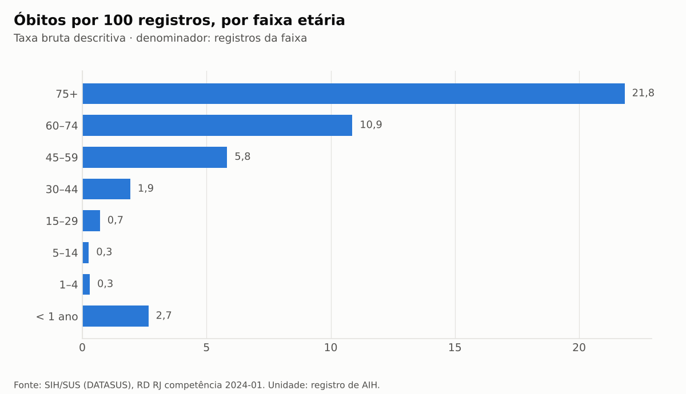
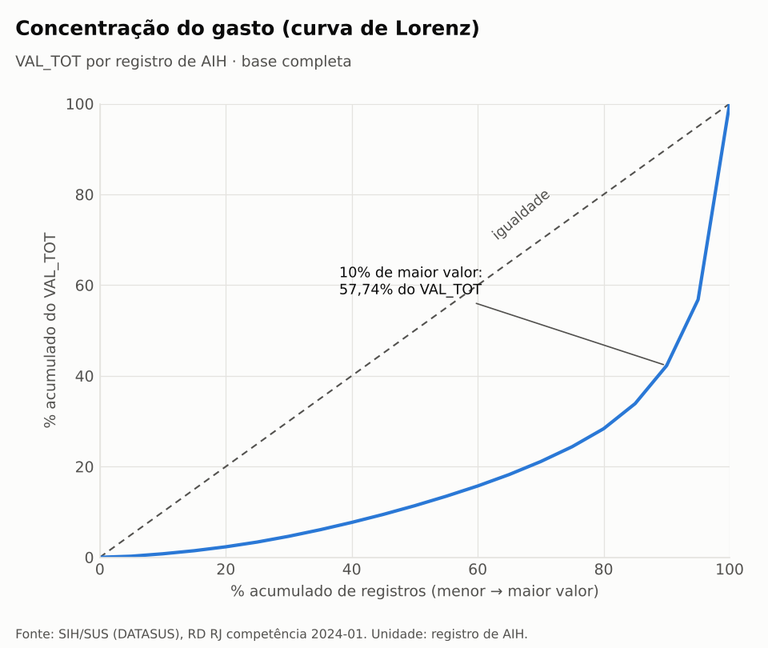
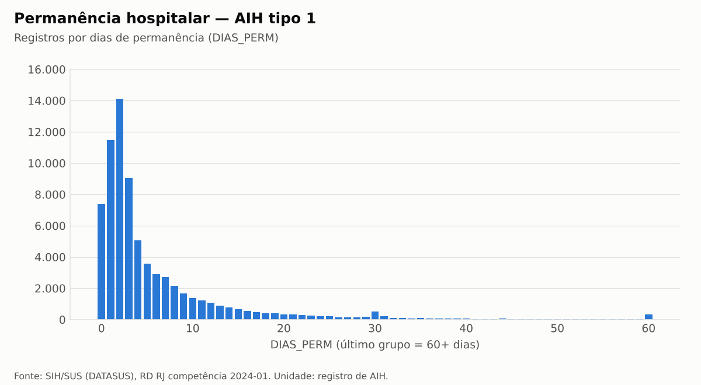

# 6. Análise exploratória

## Objetivo

Descrever o perfil dos registros de internação: quem são os pacientes registrados, em que leitos e
procedimentos, com que desfechos e a que custo. As análises são **descritivas**: nenhuma diferença entre
grupos é apresentada como causal ou como medida da qualidade do cuidado.

Relatório completo e reproduzível: [`reports/analysis/analysis.md`](../reports/analysis/analysis.md),
gerado por `hospital-analytics analysis` a partir da camada tratada, com SQL em `sql/analysis/` e
gráficos em `reports/analysis/figures/`.

## Convenções

- Unidade de análise: registro de AIH, não paciente.
- Idade em anos corrigida pela unidade `COD_IDADE` (D-025); permanência = `DIAS_PERM`.
- Mortalidade em óbitos por 100 registros do grupo; taxas brutas, sem ajuste por idade ou gravidade.
- O relatório usa os rótulos da fonte secundária e os códigos SIGTAP. Os nomes oficiais de
  procedimentos, diagnósticos e estabelecimentos estão no modelo analítico e no dashboard.

## Perfil demográfico

- 56,88% dos registros são do sexo feminino e 43,12% do masculino; o masculino responde por 51,80% do
  valor (valor médio de R$ 2.062,90 contra R$ 1.455,22).
- Entre 15 e 44 anos predomina o sexo feminino; os leitos obstétricos (`ESPEC` 02) somam 15,91% dos
  registros. É uma composição por tipo de leito, não uma conclusão clínica.
- A faixa de 60 a 74 anos é a de maior número de registros (21,40%).

## Perfil hospitalar

| Dimensão | Destaque |
| --- | --- |
| Caráter da internação | urgência: 69,27% dos registros e 58,81% do valor; eletivo: 30,45% e 40,80% |
| Complexidade | alta complexidade: 8,09% dos registros e 29,09% do valor (valor médio R$ 6.172,23) |
| Especialidade do leito | cirúrgico: 35,51% dos registros e 49,52% do valor; clínico: 34,82% e 32,23% |
| Grupo SIGTAP | clínicos: 54,66% dos registros e 45,08% do valor; cirúrgicos: 44,57% e 50,92%; transplantes: 0,57% e 3,96% |
| Estabelecimentos | 240 CNES; os 10 de maior valor concentram 30,85% do valor e 18,25% dos registros |

## Mortalidade

- A mortalidade cresce com a idade: 0,26 óbito por 100 registros entre 5 e 14 anos e 21,83 a partir de
  75 anos; abaixo de 1 ano, 2,66.
- Por leito: clínicos 15,31, cirúrgicos 2,24, obstétricos 0,02. Por caráter: urgência 7,08, eletivo 4,83.
- Essas taxas refletem a composição dos casos atendidos em cada grupo e não permitem comparar o risco
  entre eles.

## Valores

- Mediana de `VAL_TOT`: R$ 689,11; percentil 90: R$ 3.748,81; percentil 99: R$ 20.147,11; máximo:
  R$ 176.534,37.
- Os 50% de registros de menor valor somam 11,37% do total; os 10% de maior valor, **57,74%** (mesmo
  critério do indicador; a referência histórica de 58,20% não foi reproduzida).
- Os 241 registros com `VAL_TOT` igual a zero são exatamente os 241 registros de `ESPEC` 87, todos AIH
  tipo 1 com procedimentos clínicos. O código 87 é "Saúde Mental (Clínico)" na tabela oficial.

## Permanência

- AIH tipo 1: mediana de 3 dias, percentil 90 de 14, percentil 99 de 44 e máximo de 353; 7.367
  registros têm 0 dia (alta no mesmo dia) e 5.793 ficam acima do limite de Tukey (16 dias). Eles são
  contados, não removidos. Há um acúmulo visível em 30 dias, que não foi interpretado.
- AIH tipo 5 (longa permanência): `DIAS_PERM` entre 2 e 31 dias (mediana 31), porque mede o período
  coberto pela AIH. Esses valores não são comparáveis aos do tipo 1 e aparecem apenas em tabela.

## Limitações

- Uma única competência: as saídas vão de 2023-08 a 2024-01, sem série temporal.
- Sem identificador de paciente, reinternações não são identificáveis.
- Taxas brutas: não servem para comparar o desempenho de hospitais ou grupos.
