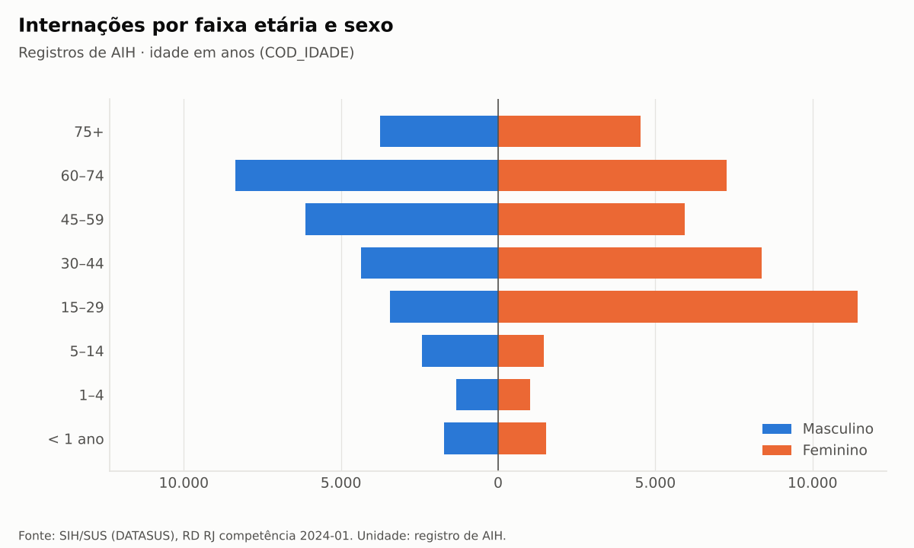
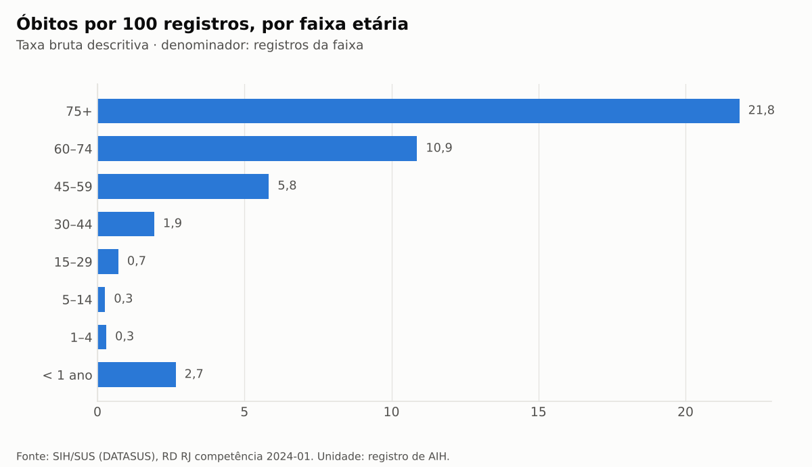
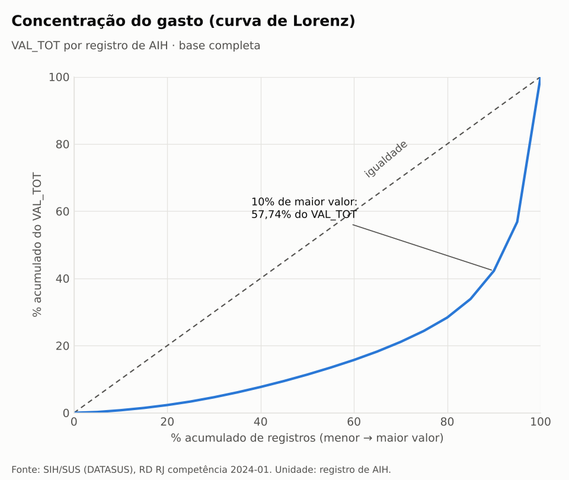
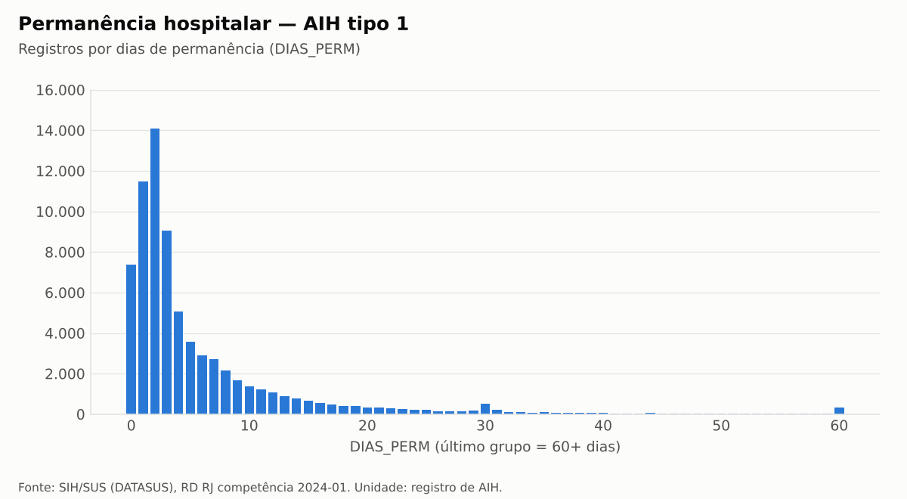

# Análises exploratórias (Fase 5)

Relatório completo, gerado e reproduzível: [`reports/analysis/analysis.md`](../reports/analysis/analysis.md)
(`make analysis`; SQL em `sql/analysis/`). **Todas as análises são descritivas.** Nenhuma diferença
entre grupos é apresentada como causal ou como medida de qualidade assistencial. Unidade de análise:
registro de AIH (não paciente). Rótulos de códigos: fonte secundária (D-020). Permanência = `DIAS_PERM`.
Idade = anos corrigidos por `COD_IDADE` (D-025).

## Perfil demográfico

- 56,88% dos registros são do sexo feminino e 43,12% do masculino; o masculino responde por 51,80%
  do valor (valor médio R$ 2.062,90 × R$ 1.455,22).
- A faixa 15–44 anos tem predomínio feminino acentuado; os leitos **obstétricos** (`ESPEC` 02)
  representam 15,91% dos registros — composição por tipo de leito, não conclusão clínica.
- 60–74 anos é a faixa com mais registros (21,40%).

## Perfil hospitalar

| Dimensão | Destaque descritivo |
|---|---|
| Caráter (`CAR_INT`) | urgência 69,27% dos registros e 58,81% do valor; eletivo 30,45% e 40,80% |
| Complexidade | alta complexidade: 8,09% dos registros, 29,09% do valor (valor médio R$ 6.172,23) |
| Leito (`ESPEC`) | cirúrgico 35,51% dos registros e 49,52% do valor; clínico 34,82% e 32,23% |
| Grupo SIGTAP | clínicos 54,66% dos registros / 45,08% do valor; cirúrgicos 44,57% / 50,92%; transplantes 0,57% / 3,96% |
| Estabelecimentos | 240 CNES; os 10 de maior valor concentram 30,85% do valor e 18,25% dos registros |

Os 15 procedimentos mais frequentes estão no relatório por **código SIGTAP**; os nomes não são
apresentados porque a Tabela SIGTAP não pôde ser consultada (P-011).

## Mortalidade (óbitos por 100 registros do grupo)

- Gradiente etário: 0,26 (5–14) → 21,83 (75+); < 1 ano: 2,66.
- Leitos clínicos 15,31; cirúrgicos 2,24; obstétricos 0,02. Urgência 7,08; eletivo 4,83.
- Taxas brutas, sem ajuste por idade ou gravidade: refletem composição (casemix), **não** risco
  comparável entre grupos.

## Análise financeira

- Mediana do `VAL_TOT` R$ 689,11; P90 R$ 3.748,81; P99 R$ 20.147,11; máximo R$ 176.534,37.
- Os 50% de registros de menor valor somam 11,37% do total; os 10% de maior valor, **57,74%**
  (mesmo critério do indicador; a referência histórica de 58,20% não foi reproduzida — `indicadores.md`).
- **241 registros com `VAL_TOT` = 0 são exatamente os 241 registros com `ESPEC` = 87** (todos AIH tipo
  1, procedimentos clínicos). O código 87 não tem rótulo na fonte secundária (P-010).

## Permanência

- AIH tipo 1: mediana 3 dias, P90 14, P99 44, máximo 353; 7.367 registros com 0 dias (mesmo dia);
  5.793 acima do limite de Tukey (16 dias) — **contados, não removidos**. Há um acúmulo visível em
  30 dias (não interpretado).
- AIH tipo 5 (longa permanência): `DIAS_PERM` entre 2 e 31 (mediana 31) — mede o período coberto pela
  AIH; por isso não é comparável à permanência da AIH tipo 1 e é mostrado só em tabela.

## Limitações

- Competência única (2024-01): saídas de 2023-08 a 2024-01; não é uma série temporal.
- Sem identificador de paciente: reinternações não são identificáveis; taxas são por registro.
- Interpretação de códigos por fonte secundária; códigos `ESPEC` 10/14/87 sem rótulo.
- Taxas brutas, sem padronização: não usar para comparar desempenho de hospitais ou grupos.
