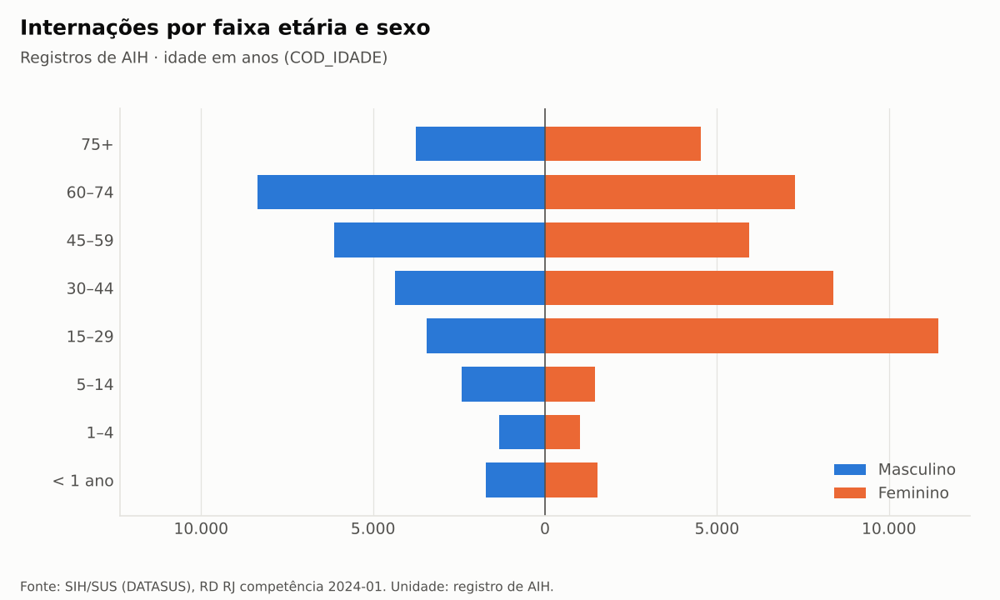
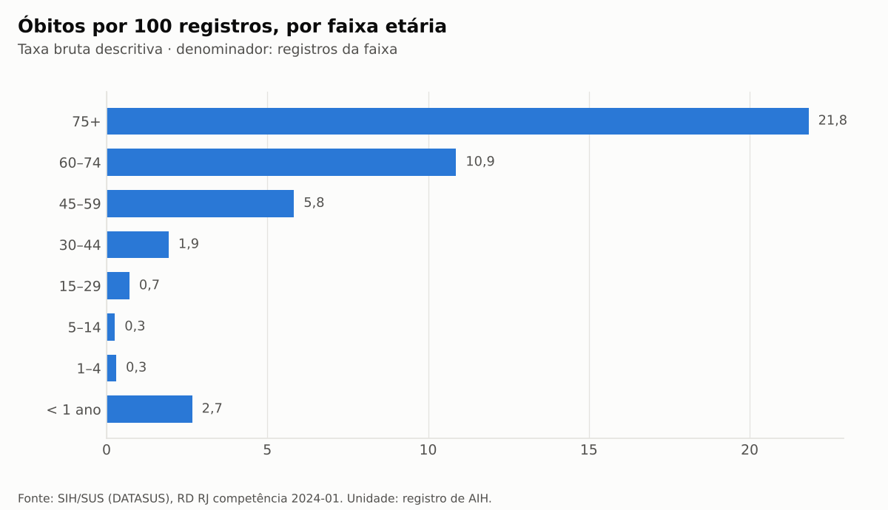
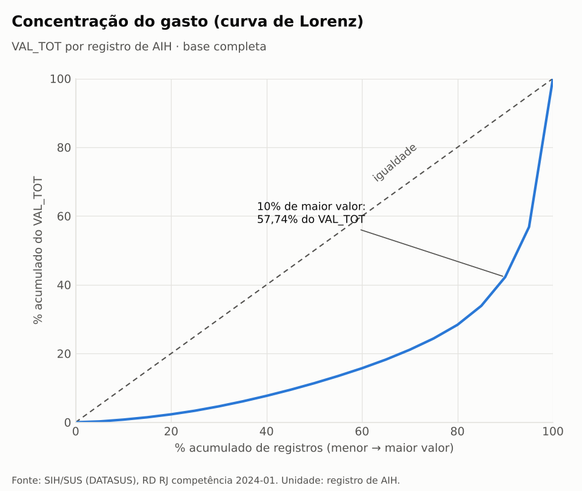
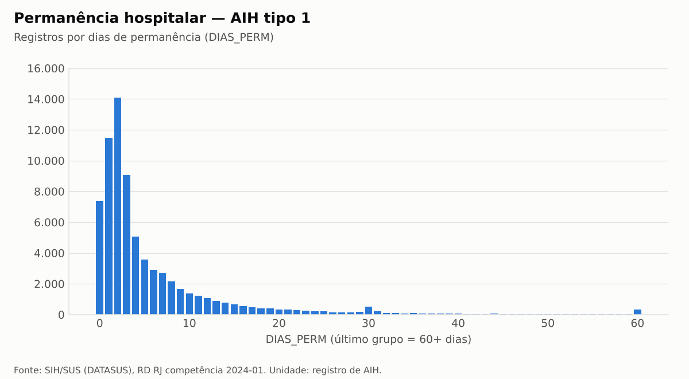

# Análises exploratórias — sih_rj_2024_01_tratado.parquet

> Gerado por `hospital-analytics analysis`. Não editar manualmente. Análises **descritivas**:
> nenhuma associação é causal. Unidade: registro de AIH. Rótulos de códigos: fonte
> secundária (ver `docs/dicionario_variaveis.md`). Permanência = `DIAS_PERM`.

Base: **73.046** registros · **R$ 125.440.636,13**.

## 1. Perfil demográfico (idade em anos corrigida por `COD_IDADE`)

| Faixa etária | Registros | % registros | % valor | Óbitos/100 reg. | Perm. média (dias) | Valor médio (R$) |
|---|---|---|---|---|---|---|
| < 1 ano | 3.238 | 4,43 | 7,75 | 2,66 | 9,21 | 3.004,20 |
| 1–4 | 2.350 | 3,22 | 1,89 | 0,30 | 4,49 | 1.010,04 |
| 5–14 | 3.879 | 5,31 | 2,75 | 0,26 | 3,70 | 888,83 |
| 15–29 | 14.872 | 20,36 | 10,58 | 0,71 | 3,94 | 892,68 |
| 30–44 | 12.732 | 17,43 | 11,74 | 1,93 | 4,83 | 1.156,43 |
| 45–59 | 12.066 | 16,52 | 19,69 | 5,83 | 6,84 | 2.047,48 |
| 60–74 | 15.635 | 21,40 | 30,97 | 10,87 | 7,64 | 2.485,11 |
| 75+ | 8.274 | 11,33 | 14,61 | 21,83 | 8,54 | 2.215,66 |

### Sexo

| Código | Rótulo | Registros | % registros | % valor | Óbitos/100 reg. | Perm. média (dias) | Valor médio (R$) |
|---|---|---|---|---|---|---|---|
| 1 | Masculino | 31.501 | 43,12 | 51,80 | 7,50 | 7,07 | 2.062,90 |
| 3 | Feminino | 41.545 | 56,88 | 48,20 | 5,54 | 5,40 | 1.455,22 |

### Raça/cor

| Código | Rótulo | Registros | % registros | % valor | Óbitos/100 reg. | Perm. média (dias) | Valor médio (R$) |
|---|---|---|---|---|---|---|---|
| 01 | Branca | 19.820 | 27,13 | 29,42 | 6,53 | 5,72 | 1.861,71 |
| 02 | Preta | 10.890 | 14,91 | 16,20 | 7,93 | 6,62 | 1.865,67 |
| 03 | Parda | 41.539 | 56,87 | 53,10 | 5,91 | 6,13 | 1.603,50 |
| 04 | Amarela | 723 | 0,99 | 1,19 | 6,64 | 7,14 | 2.056,81 |
| 05 | Indígena | 4 | 0,01 | 0,00 | 0,00 | 2,50 | 281,80 |
| 99 | Sem informação | 70 | 0,10 | 0,10 | 0,00 | 30,27 | 1.837,77 |

## 2. Perfil hospitalar

### Tipo de AIH (IDENT)

| Código | Rótulo | Registros | % registros | % valor | Óbitos/100 reg. | Perm. média (dias) | Valor médio (R$) |
|---|---|---|---|---|---|---|---|
| 1 | Principal | 72.383 | 99,09 | 98,74 | 6,43 | 5,93 | 1.711,15 |
| 5 | Longa permanência | 663 | 0,91 | 1,26 | 1,21 | 27,90 | 2.386,37 |

### Especialidade do leito (ESPEC)

| Código | Rótulo | Registros | % registros | % valor | Óbitos/100 reg. | Perm. média (dias) | Valor médio (R$) |
|---|---|---|---|---|---|---|---|
| 01 | Cirúrgico | 25.935 | 35,51 | 49,52 | 2,24 | 4,70 | 2.394,98 |
| 02 | Obstétricos | 11.618 | 15,91 | 5,79 | 0,02 | 3,05 | 624,86 |
| 03 | Clínicos | 25.437 | 34,82 | 32,23 | 15,31 | 8,42 | 1.589,55 |
| 04 | Crônicos | 713 | 0,98 | 1,16 | 13,32 | 23,18 | 2.033,11 |
| 05 | Psiquiatria | 513 | 0,70 | 0,34 | 0,19 | 14,09 | 824,30 |
| 06 | Pneumologia sanitária (tisiologia) | 146 | 0,20 | 0,20 | 5,48 | 20,37 | 1.758,07 |
| 07 | Pediátricos | 6.541 | 8,95 | 9,42 | 1,27 | 6,69 | 1.806,02 |
| 08 | Reabilitação | 9 | 0,01 | 0,01 | 0,00 | 41,00 | 1.995,40 |
| 09 | Leito dia / cirúrgicos | 1.770 | 2,42 | 1,31 | 0,06 | 0,09 | 926,66 |
| 10 | (sem rótulo) | 26 | 0,04 | 0,00 | 0,00 | 29,96 | 82,08 |
| 14 | (sem rótulo) | 97 | 0,13 | 0,03 | 0,00 | 26,96 | 323,83 |
| 87 | (sem rótulo) | 241 | 0,33 | 0,00 | 0,00 | 5,85 | 0,00 |

### Caráter da internação (CAR_INT)

| Código | Rótulo | Registros | % registros | % valor | Óbitos/100 reg. | Perm. média (dias) | Valor médio (R$) |
|---|---|---|---|---|---|---|---|
| 01 | Eletivo | 22.240 | 30,45 | 40,80 | 4,83 | 5,61 | 2.301,13 |
| 02 | Urgência | 50.601 | 69,27 | 58,81 | 7,08 | 6,36 | 1.457,99 |
| 05 | Outros tipos de acidente de trânsito | 101 | 0,14 | 0,21 | 0,00 | 5,85 | 2.590,44 |
| 06 | Outros tipos de lesões e envenenamentos por agentes químicos ou físicos | 104 | 0,14 | 0,18 | 3,85 | 3,28 | 2.172,94 |

### Complexidade (COMPLEX)

| Código | Rótulo | Registros | % registros | % valor | Óbitos/100 reg. | Perm. média (dias) | Valor médio (R$) |
|---|---|---|---|---|---|---|---|
| 02 | Média complexidade | 67.133 | 91,91 | 70,91 | 6,67 | 6,16 | 1.324,90 |
| 03 | Alta complexidade | 5.913 | 8,09 | 29,09 | 3,18 | 5,68 | 6.172,23 |

### Grupo SIGTAP do procedimento realizado

| Código | Rótulo | Registros | % registros | % valor | Óbitos/100 reg. | Perm. média (dias) | Valor médio (R$) |
|---|---|---|---|---|---|---|---|
| 02 | Procedimentos com finalidade diagnóstica | 146 | 0,20 | 0,05 | 0,68 | 2,55 | 420,74 |
| 03 | Procedimentos clínicos | 39.928 | 54,66 | 45,08 | 10,22 | 7,68 | 1.416,21 |
| 04 | Procedimentos cirúrgicos | 32.553 | 44,57 | 50,92 | 1,78 | 4,24 | 1.962,00 |
| 05 | Transplantes de órgãos, tecidos e células | 419 | 0,57 | 3,96 | 0,95 | 5,61 | 11.847,06 |

### 15 procedimentos mais frequentes (código SIGTAP)

| PROC_REA | Registros | % registros | % valor | Óbitos/100 reg. | Perm. média (dias) | Valor médio (R$) |
|---|---|---|---|---|---|---|
| 0310010039 | 4.250 | 5,82 | 2,04 | 0,00 | 2,65 | 601,61 |
| 0303010037 | 3.752 | 5,14 | 8,32 | 30,14 | 9,67 | 2.782,81 |
| 0411010034 | 3.087 | 4,23 | 1,91 | 0,03 | 3,17 | 776,06 |
| 0415010012 | 2.689 | 3,68 | 7,24 | 4,76 | 7,05 | 3.375,96 |
| 0303140151 | 2.494 | 3,41 | 4,31 | 17,56 | 9,23 | 2.167,05 |
| 0303100044 | 1.642 | 2,25 | 0,29 | 0,06 | 4,06 | 223,45 |
| 0303040149 | 1.587 | 2,17 | 2,30 | 18,08 | 7,80 | 1.821,43 |
| 0304100021 | 1.243 | 1,70 | 1,24 | 24,38 | 10,85 | 1.247,45 |
| 0303150050 | 1.197 | 1,64 | 0,73 | 8,60 | 7,45 | 768,95 |
| 0411010042 | 1.179 | 1,61 | 0,77 | 0,00 | 3,10 | 823,06 |
| 0407030034 | 1.125 | 1,54 | 1,04 | 0,00 | 2,55 | 1.156,38 |
| 0415030013 | 1.069 | 1,46 | 2,75 | 3,18 | 6,65 | 3.223,97 |
| 0303060212 | 1.053 | 1,44 | 2,30 | 18,23 | 10,57 | 2.740,78 |
| 0409060186 | 985 | 1,35 | 0,43 | 0,00 | 1,51 | 549,43 |
| 0411020013 | 924 | 1,26 | 0,18 | 0,11 | 2,11 | 246,56 |

## 3. Mortalidade

Taxas = óbitos por 100 registros de AIH do grupo (denominador: registros do grupo). Ver as
colunas *Óbitos/100 reg.* nas tabelas acima. Diferenças entre grupos refletem casemix,
tipo de leito e complexidade; **não** indicam qualidade assistencial nem causalidade.

## 4. Análise financeira

| Base | Registros | VAL_TOT = 0 | P25 (R$) | Mediana (R$) | P75 (R$) | P90 (R$) | P99 (R$) | Máx. (R$) |
|---|---|---|---|---|---|---|---|---|
| full | 73.046 | 241 | 396,18 | 689,11 | 1.206,19 | 3.748,81 | 20.147,11 | 176.534,37 |
| ident_1 | 72.383 | 241 | 393,59 | 688,11 | 1.181,51 | 3.720,68 | 20.187,67 | 176.534,37 |
| ident_5 | 663 | 0 | 1.540,74 | 2.379,41 | 2.996,36 | 3.820,91 | 4.000,62 | 4.600,28 |

- Os 50% de registros de menor valor somam **11,37%** do `VAL_TOT`; os 90% de menor
  valor somam 42,25%. Os 10% de maior valor (k = ⌊0,1·n⌋, mesmo critério do
  indicador) concentram **57,74%** — ver `docs/indicadores.md` sobre a referência histórica de 58,20% (não reproduzida).
- **240** estabelecimentos (CNES); os 10 de maior valor concentram **30,85%** do valor e 18,25% dos registros.

## 5. Permanência hospitalar

| IDENT | Registros | 0 dias | P25 | Mediana | P75 | P90 | P99 | Máx. | Limite Tukey | Acima do limite |
|---|---|---|---|---|---|---|---|---|---|---|
| 1 | 72.383 | 7.367 | 1 | 3 | 7 | 14 | 44 | 353 | 16,00 | 5.793 |
| 5 | 663 | 0 | 31 | 31 | 31 | 31 | 31 | 31 | 31,00 | 0 |

Valores acima do limite de Tukey (Q3 + 1,5·IIQ) são **contados, não removidos**. Na AIH tipo 5,
`DIAS_PERM` mede o período coberto pela AIH (máximo 31 dias), não a internação inteira.

## 6. Distribuição temporal das saídas

| Mês de saída | IDENT | Registros |
|---|---|---|
| 2023-08 | 1 | 36 |
| 2023-09 | 1 | 66 |
| 2023-10 | 1 | 4.305 |
| 2023-10 | 5 | 1 |
| 2023-11 | 1 | 7.248 |
| 2023-11 | 5 | 13 |
| 2023-12 | 1 | 17.565 |
| 2023-12 | 5 | 45 |
| 2024-01 | 1 | 43.163 |
| 2024-01 | 5 | 604 |

Todos os registros têm competência 2024-01; 40% das saídas ocorreram em 2023.

## 7. Qualidade dos dados

Ver [`reports/audit/audit_rdrj2401.md`](../audit/audit_rdrj2401.md) e `docs/qualidade_dados.md`.
